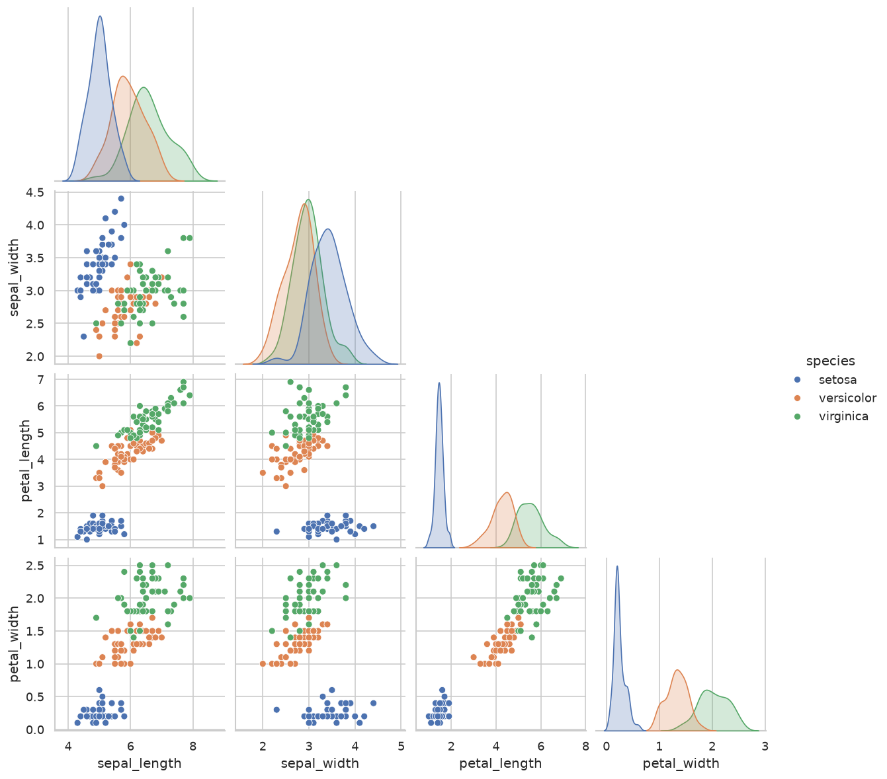
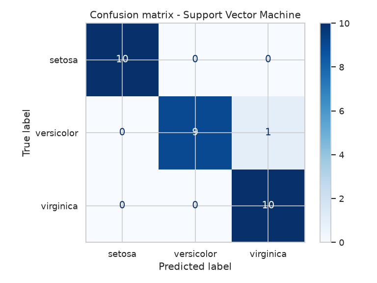

# Iris Flower Classification — CodeAlpha Data Science Internship (Task 1)

This project classifies iris flowers into **setosa**, **versicolor** and **virginica** using four measurements: sepal length, sepal width, petal length and petal width.

## Dataset
The classic Iris dataset has 150 samples, 50 per species, and no missing values. It is in `data/Iris.csv`.

## Workflow
1. **Data loading & checks.** Shape, missing values, class balance and summary statistics.
2. **Exploratory analysis.** Pair plot, box plots per species and a correlation heatmap.
3. **Train/test split.** 80/20, stratified by species.
4. **Model comparison.** Five classifiers, each scored with 5-fold cross-validation: Logistic Regression, KNN, SVM, Decision Tree and Random Forest.
5. **Evaluation.** Accuracy, precision/recall/F1 and a confusion matrix on the unseen test set.
6. **Prediction.** The best model classifies new flower measurements.

## Results
| Model | CV accuracy | Test accuracy |
|---|---|---|
| **Support Vector Machine** | **96.7%** | **96.7%** |
| K-Nearest Neighbors | 96.7% | 93.3% |
| Logistic Regression | 95.8% | 93.3% |
| Random Forest | 95.0% | 90.0% |
| Decision Tree | 94.2% | 93.3% |

- The best model is the **SVM (RBF kernel)**, with **96.7% test accuracy**.
- *Setosa* is separated perfectly. The few errors are between *versicolor* and *virginica*, whose measurements overlap.
- **Petal length and petal width** are the most important features. Sepal width contributes the least.

| Pair plot | Confusion matrix |
|---|---|
|  |  |

## Run it
```bash
pip install -r requirements.txt
python iris_classification.py
```
The charts and the model comparison table are saved in `outputs/`. The full console output is in `outputs_log.txt`.

## Tech stack
Python, Pandas, Scikit-learn, Matplotlib, Seaborn
